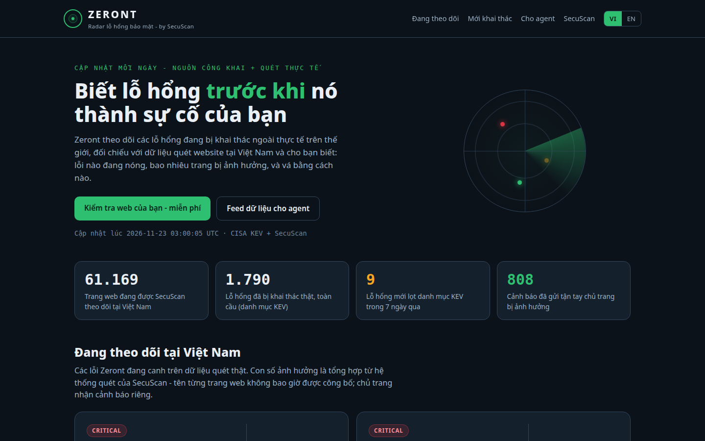

<h1 align="center">ZERONT</h1>

<p align="center"><b>Vulnerability radar - know the flaw before it becomes your incident.</b></p>

<p align="center">
  
  
  
  
</p>

<p align="center">
  <a href="https://secuscan.dannyphan.me/radar/"><b>Live radar</b></a> ·
  <a href="https://secuscan.dannyphan.me/radar/feed.json">feed.json</a> ·
  <a href="https://secuscan.dannyphan.me/radar/feed.xml">feed.xml (RSS)</a> ·
  <a href="https://secuscan.dannyphan.me/">SecuScan</a>
</p>



## What is Zeront?

Zeront is a daily vulnerability radar built by [SecuScan](https://secuscan.dannyphan.me/). It does three things most CVE feeds do not:

1. **Worldwide signal, filtered for reality.** New entries to CISA's Known Exploited Vulnerabilities (KEV) catalog - flaws with evidence of real-world exploitation, not theoretical scanner noise.
2. **Local impact, measured - not guessed.** Flaws tracked against SecuScan's real scan data in Vietnam, with verified aggregate counts of affected websites (for example: 830 verified sites affected by the nginx "nginx2root" flaws, CVE-2026-123007 / CVE-2026-123633).
3. **The fix, in plain language.** Every tracked item ships with the affected version range and exactly how to patch it.

The name is a wink at "zero day": Zeront exists so a known flaw never gets to be *your* zero day.

## For agents and developers

Everything on the radar page is published as machine-readable data, refreshed daily by GitHub Actions:

| Endpoint | Format | Contents |
|---|---|---|
| `feed.json` | JSON | Full radar: tracked items, new KEV entries, aggregate stats |
| `feed.xml` | RSS 2.0 | Same items as a subscribable feed |
| `index.html` | HTML + JSON-LD | Human page; embeds a schema.org `Dataset` description |

```bash
curl https://secuscan.dannyphan.me/radar/feed.json
```

Agents, bots and internal tools may crawl and reuse the feed freely under the MIT license. Crediting Zeront / SecuScan is appreciated.

**No agent of your own tooling?** The radar page has a **"Copy the prompt"** button: paste it into ChatGPT, Claude or any assistant, fill in your website address, and that agent will check your site against the radar immediately - and, where the platform supports scheduling, re-check daily and only interrupt you when a flaw matches your stack.

## Data policy - the double-edged sword, handled

Publishing fresh vulnerability intel can help attackers as well as defenders. Zeront draws a hard line:

- **Published:** CVE metadata from public sources (CISA KEV, NVD) that attackers already monitor, plus **aggregate counts** (how many sites are affected).
- **Never published:** the name, address, or patch status of any individual website. Site owners are warned privately by SecuScan; only they can see their own site's detail, via their personal dashboard code.

This page gives attackers no target they did not already have. It gives defenders earlier warning and a sense of scale.

## Browser extension

`extension/` contains the Zeront Chrome/Edge extension (Manifest V3, v0.1.0):

- **Popup:** fingerprints the current tab (server banner, generator meta, in-page technology traces) and evaluates it against the radar's tracked items - version-range matches and technology signals, with honest certainty notes.
- **Your websites:** register your domains in the options page and grant per-domain permission; a daily background job re-checks them and badges the icon on a match. No admin passwords, no server access - public fingerprints only.
- **Daily radar:** the feed refreshes every day; newly tracked flaws raise a notification.
- No browsing-history collection; everything stays in the user's browser.

Install: download `zeront-extension-v0.1.0.zip` from the [v0.1.0 release](https://github.com/dankezo/zeront/releases/tag/v0.1.0), unzip, then `chrome://extensions` → Developer mode → Load unpacked. Full guide: [extension.html](https://dankezo.github.io/zeront/extension.html). Build the zip yourself with `extension/build.sh`. A Chrome Web Store listing is in preparation (one-time US$5 developer registration).

## How it works

```
CISA KEV catalog ──┐
                   ├─► tools/build_feed.py ─► feed.json / feed.xml / data.js ─► radar page
SecuScan aggregates┘        (daily, GitHub Actions)
```

- `data/aggregates.json` - aggregate scan figures from SecuScan (totals only, updated per scan round).
- `data/featured.json` - flaws actively tracked in Vietnam, with verified affected counts and fixes.
- `tools/build_feed.py` - merges the public KEV catalog with the two files above. If the KEV fetch fails, it falls back to `data/kev_seed.json` so the page never breaks.

No AI tokens are spent per reader or per scan: matching is deterministic code over public data, and reports are templates filled with measured numbers - the same code-first design SecuScan uses to scan tens of thousands of websites.

## Run it locally

```bash
python3 tools/build_feed.py   # regenerates feed.json, feed.xml, data.js
python3 -m http.server        # open http://localhost:8000
```

## Part of SecuScan

Zeront is the public radar of **[SecuScan](https://secuscan.dannyphan.me/)** - recurring website security checks for small businesses: daily scanning, plain-language reports, and private warnings when your site is affected by a flaw like the ones tracked here.

## License

MIT - see [LICENSE](LICENSE).

## Architecture: one feed, three consumers

Zeront is a single daily data pipeline with three consumers:

1. **The radar page** (humans) - renders `feed.json` data with
   plain-language Vietnamese summaries (`plain_vi`), short impact labels
   (`impact_vi` / `impact_en`) and urgency derived from the CISA due date.
2. **The browser extension** - matches the user's own sites against
   `featured[].match` rules from the same feed and alerts on a hit.
3. **AI agents** - `feed.json` (schema `zeront-feed/2`), `feed.xml` (RSS)
   and `llms.txt` describe the whole radar in machine-readable form,
   including per-flaw impact labels and days-to-deadline (`due_in_days`).

The daily SecuScan scan process writes `data/aggregates.json` (aggregate
counts only); `tools/build_feed.py` merges it with the live CISA KEV
catalog and the hand-written plain-language summaries in
`data/plain_vi.json`, then republishes every surface at once. New KEV
entries without a hand-written summary fall back to a deterministic
impact label derived from the vulnerability name - never to invented
impact figures. Vietnam affected counts exist only for flaws SecuScan
has actually scanned and verified.
